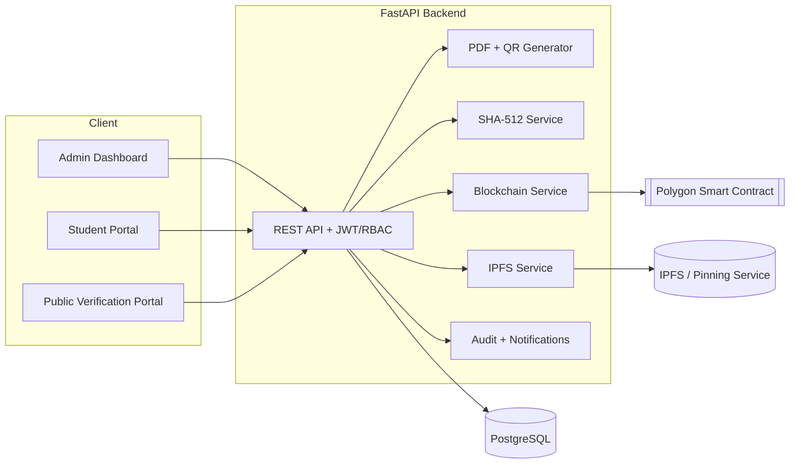
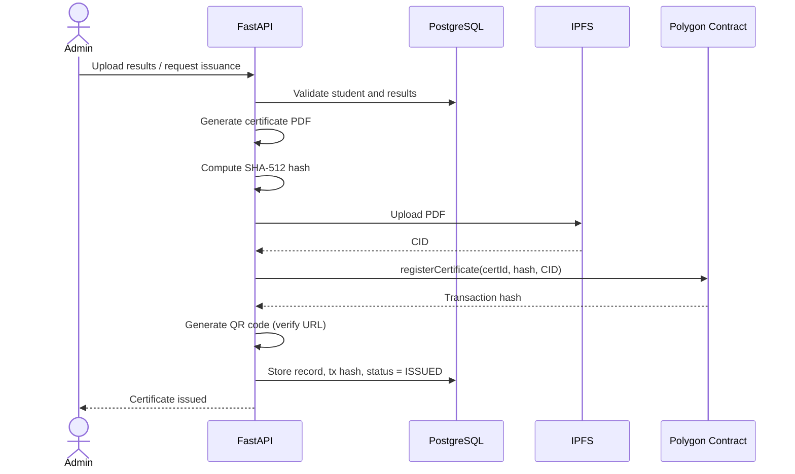
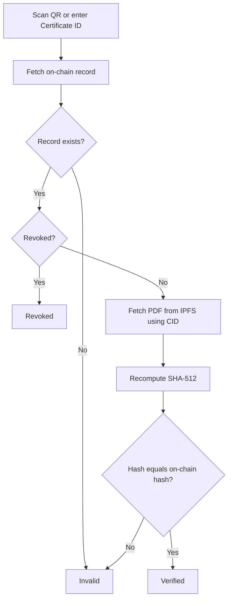
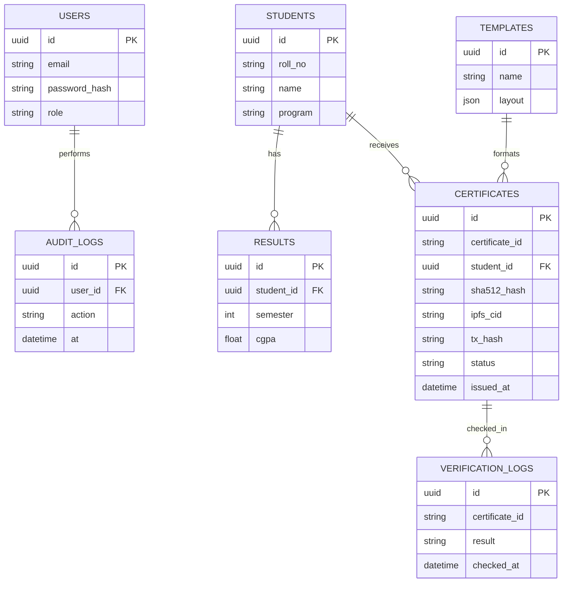

# CertiLedger – Technical Design Document

## 1. Overview
CertiLedger issues academic certificates as PDFs, hashes them with SHA-512, stores them on IPFS, and registers the hash and CID on Polygon. Verification recomputes the hash and compares it with the on-chain record.

## 2. System Architecture

## 3. Certificate Issuance Flow

## 4. Verification Flow

Optionally the verifier uploads a PDF; its hash is compared instead of the IPFS copy.

## 5. Data Model

## 6. Smart Contract Design
| Function | Access | Purpose |
|---|---|---|
| `registerCertificate(certId, sha512Hash, cid)` | Issuer only | Store hash and CID; reject duplicates |
| `revokeCertificate(certId)` | Issuer only | Mark certificate revoked |
| `getCertificate(certId)` | Public (view) | Return hash, CID, issuer, timestamp, revoked flag |

Events: `CertificateRegistered`, `CertificateRevoked`. Because SHA-512 is 64 bytes, store it as `bytes` or two `bytes32` values.

## 7. REST API (summary)
| Method | Endpoint | Role |
|---|---|---|
| POST | `/api/auth/login` | Public |
| POST | `/api/students`, `/api/results/upload` | Admin |
| POST | `/api/certificates/issue` | Admin |
| POST | `/api/certificates/{id}/revoke` | Admin |
| GET | `/api/certificates/me` | Student |
| GET | `/api/verify/{certificateId}` | Public/Verifier |

## 8. Access Control
| Capability | Admin | Student | Verifier |
|---|---|---|---|
| Manage students/results | Yes | No | No |
| Issue/revoke certificates | Yes | No | No |
| View/download own certificates | No | Yes | No |
| Verify certificates | Yes | Yes | Yes |

## 9. Security
JWT authentication, RBAC, SHA-512 integrity, digital signatures on issued records, encrypted wallet key storage, audit logging, input validation, and an approval step for data entry.

## 10. Risks and Mitigation
| Risk | Mitigation |
|---|---|
| Blockchain transaction delays | Use Polygon; retry with status tracking |
| Loss of wallet keys | Secure key management, encrypted backups |
| Unauthorized access | JWT and RBAC |
| Network outages | Database backups, retry mechanisms |
| IPFS node availability | Reliable pinning services |
| Revocation management | On-chain revocation flag plus status checks |
| Human data entry errors | Validation rules, approval workflow |
| Scalability | Modular architecture, cloud deployment |
